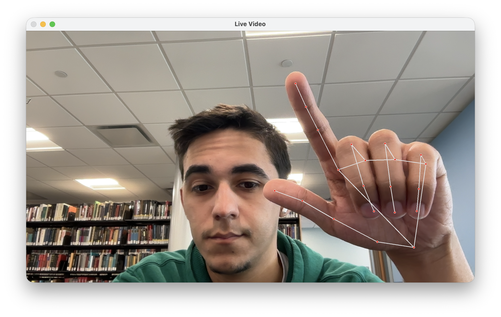

# A place to keep my ideas and problems I encounter throughout

## Intitial thoughts
Some questions arise about this project, starting this out im curious on how we use the matricies for RGB values to handoff to the Neural Network to identify against different backgrounds, hands orientation, and skin colors. 

Media Pipe seems to be the main driver for this project, where the program will capture frames from a live feed and pass that through MediaPipe. MP (Media Pipe) then passes an x,y value for list of different identified coordinates. When that is returned we can identify a gesture to then activate a command. 

# CursorControl.py
Seems to be a straightforward application that uses cv2 to capture video feed from connected cameras. 
Some issues I ran into were that the tutorial i used was from a few years back and the current python (3.14) did not have MediaPipe.Solutions. 
I could try and see what updated on the mediapipe side but for ease of following along with the tutorial, 
I downgraded my python environment to 3.11 to best match the results shown.

I was able to gather an image from CV2 and pass it through mediapipe
which then found landmarks on my hand and created points just based off the matricies
of RGB off each frame of the video.
Then over-layered a connection map of each landmark. 

I finally got reliable tracking of the cursor. An issue I ran into is that when attempting
to click the cursor would follow my finger tip making the intended cursor click miss when trying to click.
To address this I ended up making the cusor not follow the finger tip but instead follow the index knuckle.
When you click (pinch) it would stay stable as you pinch. 

Scrolling was pretty straight forward. There are anchor points that stay with the hand and when certain hand landmarks get close to the screen border it reacts as expected when the entire palm is shown.

